  

  
  
  

  「肉体羸弱，机械恒昌。」

我给 **DeepSeek Harness（DSH）** 写插件：一块在你走神时亮起来的显像管，一封把提示词翻译成祷文的转换器。都是自己每天在用的东西，所以做得比较较真——全 GPU 合成、零运行时依赖、不魔改宿主。

*I build plugins for DeepSeek Harness: CRT idle screens and machine-god litanies. Made for daily use, so they are built carefully — GPU-composited, zero-dependency, no monkey-patching.*

---

## ▚ 01 · 正在造

### 🖥️ [dsh-idle-crt](https://github.com/yuanzephyr920-oss/dsh-idle-crt) — 待机显像管

没有会话在跑、并且十分钟没人碰键鼠时，DSH 的页面会盖上一块 CRT 板：辉光字、扫描线、循环反色扫掠、鼠标视差微动。点一下窗口，或者随便按个键，它就散了。

`逐帧全 GPU 合成` `60 fps` `零运行时依赖` `派生自 dsh-splash-crt`

### 📜 [dsh-om-messiah](https://github.com/yuanzephyr920-oss/dsh-om-messiah) — 祷文转换

你发出去的每一句提示词，会先被改写成一篇万机之神祷文；发祷文还是发原文，由你在发送前自己决定。带设置页，也提供不装插件就能用的本地反向代理。

`Host 插件` `发送前确认` `本地反代` `可自定义祷文风格`

### 🗂️ [awesome-dsh-plugin](https://github.com/yuanzephyr920-oss/awesome-dsh-plugin) — 插件目录

DSH 插件市场的收录仓库，我的插件条目在这里提交与维护。

---

## ▚ 02 · 工作台

  
  
  
  
  
  
  
  

插件之外，也常和工具链本身较劲：加载顺序、渲染管线、热重载，以及这台 Windows 机器上的各种坑。

---

## ▚ 03 · 三条做法

1. **不魔改宿主。** 插件只在边缘生长——DSH 的 `cordis.patch.yml` 加一行插入层，关掉就还原，宿主升级也不会打架。
2. **能上 GPU 就别上 CPU。** idle-crt 把文字与提示各预渲染成一层纹理，逐帧只在片元着色器里合成：RTX 4060 上稳定 16.6 ms/帧。
3. **装完就能用。** 一条 `dsh plugin --profile desktop add <包名>`，没有构建步骤，没有运行时依赖。

---

## ▚ 04 · 终端

- **npm** — [dsh-idle-crt](https://www.npmjs.com/package/dsh-idle-crt) · [dsh-om-messiah](https://www.npmjs.com/package/dsh-om-messiah)
- **问题与需求** — [Issues](https://github.com/yuanzephyr920-oss/dsh-idle-crt/issues)，或者直接 @ 我
- **想看看内部** — [dsh-idle-crt](https://github.com/yuanzephyr920-oss/dsh-idle-crt) 的 `lib/` 里，宿主半边和浏览器半边是分开写的

◆ 赞美万机之神 · Praise the Omnissiah ◆

